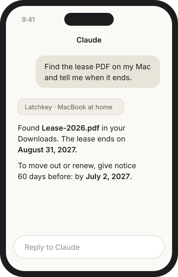

# Latchkey

**Use your Mac from Claude, wherever you are.**

Ask Claude on your phone to add eggs to your grocery note, find what Sarah said about Saturday, or
read the PDF sitting in your Downloads. It happens on your Mac at home, even with the lid closed
and nothing set up on your router. If your Mac is asleep, Claude tells you right away.

**Free and open source** · Mac with Apple silicon (M1 or newer), macOS 26 or later · Linux servers too

## What Latchkey does

Latchkey is a small menu bar app for your Mac. It connects your Mac to Claude, so Claude, in any
Claude app (phone, web, desktop), can work with what's on your Mac:

- **Notes:** find and read your notes; create notes; change plain notes.
- **Messages:** find and read conversations; send texts and files; delete one message (Claude
  does this for a sign-in code text it has used).
- **Mail:** find and read recent emails in Apple Mail, and mark one read and archive it (for
  when Claude has no email tool of its own, such as a sign-in code sent by email); nothing is
  written or sent.
- **WhatsApp:** find and read chats (from WhatsApp for Mac).
- **Calendar and Reminders:** see, add, change, and delete events and reminders; answer and send
  invitations.
- **Contacts, location, and maps:** look people up, add or change contacts, find places and
  directions. When Claude says where to look, it gets only places within 50 km of there.
- **Files:** find, read (including PDFs and pictures), write, move, and trash files.
- **Command line:** run commands, as you, never as administrator, including builds with
  Xcode's and Swift's tools, and an app's tests when Claude says it will open apps (the tests
  then run outside the command's limits on where it may write, as an opened app does).
- **Safari and the web:** open pages and read, click, type, upload, and download: sites you are
  signed in to in a background Safari tab of Claude's (your real sign-in), other sites in a
  hidden browser of Latchkey's own; and read and act in your own Safari tabs when you ask.
  Claude's Safari tabs close when Claude is done with them, after 30 minutes unused, or when
  Latchkey quits; your own tabs stay. Claude keeps at most 10 pages open; when all 10 are open,
  the one unused longest makes way for a new one once nobody has used it for 5 minutes. Two
  chats working in your Safari tabs at once take turns, so one chat's click never lands in the
  tab another chat picked.
- **Signing in:** Claude signs in on its own pages the way you would, reading each page and
  pressing its buttons itself; Latchkey only types your saved user name, password, or a
  verification code into the field Claude names, presses the button Claude names right after,
  and empties what it typed. Claude never sees a password or a code from Passwords, only the
  list of sites and user names, and Latchkey never decides whether a sign-in worked: Claude reads the page.
  The passwords and codes come from Apple's Passwords. Latchkey keeps its copy only on your Mac;
  you hand it over with one Touch ID (Latchkey's menu → Export Passwords to Latchkey…), and a
  weekly notification reminds you to do it again. The exported file is deleted as soon as
  Latchkey has read it, and an export that stops leaves no file behind. It types only on the
  site a password was saved for, a password only into a password field, never on another site's
  page, and never in your own Safari tabs. For a site it has your password for, Latchkey's own
  browser keeps its own sign-in instead of copying Safari's, locked or unlocked, so your Safari
  stays signed in; it keeps that sign-in on your Mac (in its Keychain, out of Claude's reach)
  across restarts. Some sites' protection against bots turns away that hidden browser but lets
  Safari through: while the Mac is unlocked, Claude can move such a page into a background
  Safari tab of its own and sign in there; while it is locked, Claude tells you the site needs
  the Mac unlocked. A verification code from Passwords is typed by Latchkey; a code a site texts
  or emails you, Claude reads itself (from Messages, from its own email tool, or from Apple Mail
  with the Mail tools), waits for as long as it likes, types it with Latchkey, and then deletes
  that text (through Messages' window in the background, the one exception to "never in your
  way" here) or archives that email. Being compared on many sites, two more ways for such a
  code: Latchkey finds the site's newest code in your texts or email itself and types it
  without Claude seeing it, or types Claude's code only if a recent text or email from that site
  holds it; either way Latchkey then deletes that text or archives that email. Neither reads
  anything while Messages or Mail is Off in Latchkey's settings. Not yet: passkeys.
- **The screen:** take a picture of it, and control the computer when you ask. Without the
  pointer, Claude can press an app's buttons and pick a row in its lists or sidebar.

Your Mac never has to accept connections from the internet: Latchkey reaches out to a small
service of yours online, the relay, and Claude talks to the relay. You decide which of these
Claude may use, one by one.

> **Latchkey is in testing.** [Download Latchkey](https://github.com/tonimelisma/latchkey/releases/latest/download/Latchkey.dmg)
> for a Mac with Apple silicon and macOS 26 or later. It isn't notarized by Apple yet, so macOS
> asks once per version: see step 1.

## Get started

1. **Install Latchkey on your Mac.** [Download it](https://github.com/tonimelisma/latchkey/releases/latest/download/Latchkey.dmg),
   open the download, and drag Latchkey to Applications. The first time you open it, macOS says
   it can't check the app: click **Done**, open **System Settings → Privacy & Security**, scroll
   down, click **Open Anyway** next to Latchkey, and confirm. After that it opens like any app.
   Latchkey's menu tells you when a newer version is out (download it the same way).
2. **Let Claude set it up with you** (about 20 minutes; needs Claude Pro or Max, for the Code
   tab). In Latchkey's first setup step, click
   **Copy Request**. Open the Claude app on your Mac, click the **Code** tab, paste, and press
   Return. Claude builds your relay, a small always-on service on the internet where Claude and
   your Mac meet, and walks you through the rest one click at a time:
   - sign in to Google Cloud and add a card (Google asks for one; the relay stays within its
     free tier, and Google emails you if anything ever costs more than $1);
   - create your relay account on a page Claude opens, with a code Claude gives you, and save a
     passkey with Touch ID; then connect Latchkey to it;
   - allow macOS's permissions, so macOS never stops Claude to ask while you're away (you can
     turn any ability off later);
   - add Latchkey to Claude: Claude opens a form already filled in; click **Add**, then **Add**
     once more and **Connect**; on the Latchkey page that opens, use Touch ID and click
     **Allow**.
3. **Ask Claude something about your Mac**, from your phone or anywhere.

Already have a relay? Paste its address in Latchkey's first setup step and click Connect;
Latchkey's last step, **Add to Claude**, does the rest, and keeps reminding you until Claude is
connected. If that button doesn't work: on claude.ai, click **Customize**, then **Connectors**,
then **Add custom connector**, and paste your relay's address with `/mcp` right after it (no
space), like `https://relay.example.com/mcp`. Do this once; Claude on your phone then has it too.

[Every step in detail](docs/how-it-works.md#setting-up-the-mac-app-in-detail).

## What you can ask

- "What's on my calendar tomorrow? Text Sam that I'll be late."
- "Find the lease PDF and tell me when it ends."
- "What did the family WhatsApp group decide about Saturday?"
- "How much disk space is free? Is my backup still running?"
- "Check my order status on that site I'm signed in to."
- "Add milk to my shopping list and remind me at 6."

Claude can use your Notes, Messages, WhatsApp (reading), Calendar, Reminders, Contacts, files,
Safari, the command line, location and maps, and the screen, but only what you turn on. Email
isn't included: your mail provider's own Claude connector does that better.

## What works when

Latchkey never gets in your way. While you're at the Mac, it doesn't bring windows to the front,
doesn't take over an app you might be using, and doesn't move your pointer or type into your
apps. It works in the background instead.

- **Even while the Mac is locked** (lid open or closed): files and the command line; Notes
  (find, read, create, and change plain notes); Messages (find, read, and send to a person or an
  existing conversation; a message Claude deletes goes at the next unlock); Mail (find and read
  recent emails; one Claude archives is archived at the next unlock); WhatsApp (find and read); Calendar (everything, including invitations);
  Reminders (create, change, complete, delete); Contacts; location and maps; web pages Claude
  opens itself. While the Mac is locked those open in a hidden browser of Latchkey's own with a
  copy of your Safari sign-ins. **That copy can sign you out in Safari:** a site like Target
  renews its sign-in when the copy uses it, and the one Safari holds stops working, so you may
  have to sign in again there after unlocking. Once you unlock, that browser drops its copy.
  Sites Latchkey has your password for are the exception: it signs in to them itself and copies
  nothing, so Safari stays signed in. Each page has a short name, so two
  chats never load over each other's pages. When a page in
  that browser asks to confirm something ("Remove item?"), Claude is shown the question and
  answers it; if it doesn't within 5 minutes, the page gets Cancel. Every answer says which
  browser it came from, and every answer from the Mac says whether it is locked or unlocked.
- **Only while the Mac is unlocked:** web pages of sites you are signed in to, which open in a
  background tab of Claude's at the end of your front Safari window, with your real sign-in, so
  nothing is copied and nothing signs you out (your front tab stays in front; other sites open
  in Latchkey's hidden browser, with none of your sign-ins, and sites it has your password for
  open there too, signed in with its own session); your own Safari tabs (Claude reads
  and acts in them in the background when you ask; Safari mostly stops answering while the Mac
  is locked); looking at the screen; computer control; handing your sign-ins over from
  Passwords (you click Export, and approve with Touch ID).
- **Computer control is the one exception to "never in your way":** it uses the real mouse and
  keyboard, so you'll see it. It's there for when you ask Claude to use the computer. Exporting
  your sign-ins also brings Passwords forward for a few seconds, only because you clicked
  Export.
- **Not offered, because it would need an app's window while you might be using it:** changing
  notes that have checklists, links, or pictures; Messages' reactions, inline replies, edits,
  new groups; sending WhatsApp messages; setting flags, tags, subtasks, or sections in Reminders.

## You stay in charge

- **You choose what Claude can do.** Each ability is Off, Read only, or Read & write. One that's
  off doesn't exist as far as Claude knows.
- **You approve every Claude app** that connects, and can remove any of them later.
- **You hear about every change to your account.** The relay emails you whenever a machine is
  connected, a Claude app is allowed, or your account is recovered, with the time and the IP
  address it came from, so if it wasn't you, you know at once and can remove it.
- **You see everything Claude did**, with a notification for every change.
- **You can pause Claude in one click** from the menu bar.
- **A full record of everything, kept for good.** Your Mac, each Linux server, and the relay
  each keep every call Claude made, with what it asked and everything it got back (screenshots
  included), in files of one day each that nothing ever rewrites or deletes. Your Mac's are
  encrypted, the relay's are encrypted and go when you delete your account, and you can
  export them all in one shape, to run evals over everything that happened.
- **Claude reports what didn't work.** Whenever something Claude did through Latchkey didn't
  fully work, it files a short report with Latchkey's feedback tool. The relay keeps it
  encrypted and copies it to your Mac as a text file in Latchkey's folder
  (`~/Library/Application Support/Latchkey/Feedback`), so it can be looked into and fixed.
  Nobody is notified.
- **It never interrupts you.** What Claude does on your Mac happens in the background, except
  computer control, which you'll see.
- **Nothing is left behind.** What Claude starts is cleaned up when it's done.

## Also

- **[Linux servers](docs/how-it-works.md#add-a-linux-server):** add a home server, a Raspberry
  Pi, or a rented server with one command.
- **[Run your own relay](docs/self-hosting.md):** on Google Cloud with Claude Code's help, or
  anywhere that runs a container.
- **[How it works](docs/how-it-works.md):** what runs where, every tool, privacy in detail.
- **[Security](SECURITY.md):** report a problem privately; the
  [threat model](docs/threat-model.md) says what is protected and how.
- **[Build from source and contribute](docs/development.md).**

Apache-2.0. Made by Toni Melisma.
