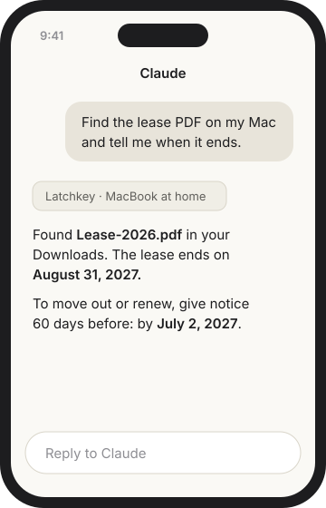

# Latchkey

**Use your Mac from Claude, wherever you are.**

Ask Claude on your phone to add eggs to your grocery note, find what Sarah said about Saturday, or
read the PDF sitting in your Downloads. It happens on your Mac at home, even with the lid closed
and nothing set up on your router. If your Mac is asleep, Claude tells you right away.

**Free and open source** · Mac with Apple silicon (M1 or newer), macOS 26 or later · Linux servers too

## What Latchkey does

Latchkey is a small menu bar app for your Mac. It connects your Mac to Claude, so Claude, in any
Claude app (phone, web, desktop), can work with what's on your Mac:

- **Notes:** find and read your notes; create notes; change plain notes.
- **Messages:** find and read conversations; send texts and files.
- **WhatsApp:** find and read chats (from WhatsApp for Mac).
- **Calendar and Reminders:** see, add, change, and delete events and reminders; answer and send
  invitations.
- **Contacts, location, and maps:** look people up, add or change contacts, find places and
  directions.
- **Files:** find, read (including PDFs and pictures), write, move, and trash files.
- **Command line:** run commands, as you, never as administrator.
- **Safari:** open pages and read, click, type, upload, and download, signed in as you.
- **The screen:** take a picture of it, and control the computer when you ask.

Your Mac never has to accept connections from the internet: Latchkey reaches out to a small
service of yours online, the relay, and Claude talks to the relay. You decide which of these
Claude may use, one by one.

> **Latchkey is in testing.** [Download Latchkey](https://github.com/tonimelisma/latchkey/releases/latest/download/Latchkey.dmg)
> for a Mac with Apple silicon and macOS 26 or later. It isn't notarized by Apple yet, so macOS
> asks once per version: see step 1.

## Get started

1. **Install Latchkey on your Mac.** [Download it](https://github.com/tonimelisma/latchkey/releases/latest/download/Latchkey.dmg),
   open the download, and drag Latchkey to Applications. The first time you open it, macOS says
   it can't check the app: click **Done**, open **System Settings → Privacy & Security**, scroll
   down, click **Open Anyway** next to Latchkey, and confirm. After that it opens like any app.
   Latchkey's menu tells you when a newer version is out (download it the same way).
2. **Let Claude set it up with you** (about 20 minutes; needs Claude Pro or Max, for the Code
   tab). In Latchkey's first setup step, click
   **Copy Request**. Open the Claude app on your Mac, click the **Code** tab, paste, and press
   Return. Claude builds your relay, a small always-on service on the internet where Claude and
   your Mac meet, and walks you through the rest one click at a time:
   - sign in to Google Cloud and add a card (Google asks for one; the relay stays within its
     free tier, and Google emails you if anything ever costs more than $1);
   - create your relay account on a page Claude opens, with a code Claude gives you, and save a
     passkey with Touch ID; then connect Latchkey to it;
   - allow macOS's permissions, so macOS never stops Claude to ask while you're away (you can
     turn any ability off later);
   - add Latchkey to Claude: Claude opens a form already filled in; click **Add**, then **Add**
     once more and **Connect**; on the Latchkey page that opens, use Touch ID and click
     **Allow**.
3. **Ask Claude something about your Mac**, from your phone or anywhere.

Already have a relay? Paste its address in Latchkey's first setup step and click Connect;
Latchkey's last step, **Add to Claude**, does the rest, and keeps reminding you until Claude is
connected. If that button doesn't work: on claude.ai, click **Customize**, then **Connectors**,
then **Add custom connector**, and paste your relay's address with `/mcp` right after it (no
space), like `https://relay.example.com/mcp`. Do this once; Claude on your phone then has it too.

[Every step in detail](docs/how-it-works.md#setting-up-the-mac-app-in-detail).

## What you can ask

- "What's on my calendar tomorrow? Text Sam that I'll be late."
- "Find the lease PDF and tell me when it ends."
- "What did the family WhatsApp group decide about Saturday?"
- "How much disk space is free? Is my backup still running?"
- "Check my order status on that site I'm signed in to."
- "Add milk to my shopping list and remind me at 6."

Claude can use your Notes, Messages, WhatsApp (reading), Calendar, Reminders, Contacts, files,
Safari, the command line, location and maps, and the screen, but only what you turn on. Email
isn't included: your mail provider's own Claude connector does that better.

## What works when

Latchkey never gets in your way. While you're at the Mac, it doesn't bring windows to the front,
doesn't take over an app you might be using, and doesn't move your pointer or type into your
apps. It works in the background instead.

- **Even while the Mac is locked** (lid open or closed): files and the command line; Notes
  (find, read, create, and change plain notes); Messages (find, read, and send to a person or an
  existing conversation); WhatsApp (find and read); Calendar (everything, including invitations);
  Reminders (create, change, complete, delete); Contacts; location and maps; web pages Claude
  opens itself, in a browser of Latchkey's own that uses your Safari sign-ins.
- **Only while the Mac is unlocked:** Safari (Claude opens a tab of its own behind yours, in the
  background, and can also read and act in your tabs when you ask); looking at the screen;
  computer control.
- **Computer control is the one exception to "never in your way":** it uses the real mouse and
  keyboard, so you'll see it. It's there for when you ask Claude to use the computer.
- **Not offered, because it would need an app's window while you might be using it:** changing
  notes that have checklists, links, or pictures; Messages' reactions, inline replies, edits,
  new groups; sending WhatsApp messages; setting flags, tags, subtasks, or sections in Reminders.

## You stay in charge

- **You choose what Claude can do.** Each ability is Off, Read only, or Read & write. One that's
  off doesn't exist as far as Claude knows.
- **You approve every Claude app** that connects, and can remove any of them later.
- **You see everything Claude did**, with a notification for every change.
- **You can pause Claude in one click** from the menu bar.
- **Your content stays yours.** Your notes, messages, and files pass through the relay to
  Claude and are never stored there.
- **It never interrupts you.** What Claude does on your Mac happens in the background, except
  computer control, which you'll see.
- **Nothing is left behind.** What Claude starts is cleaned up when it's done.

## Also

- **[Linux servers](docs/how-it-works.md#add-a-linux-server):** add a home server, a Raspberry
  Pi, or a rented server with one command.
- **[Run your own relay](docs/self-hosting.md):** on Google Cloud with Claude Code's help, or
  anywhere that runs a container.
- **[How it works](docs/how-it-works.md):** what runs where, every tool, privacy in detail.
- **[Security](SECURITY.md):** report a problem privately; the
  [threat model](docs/threat-model.md) says what is protected and how.
- **[Build from source and contribute](docs/development.md).**

Apache-2.0. Made by Toni Melisma.
