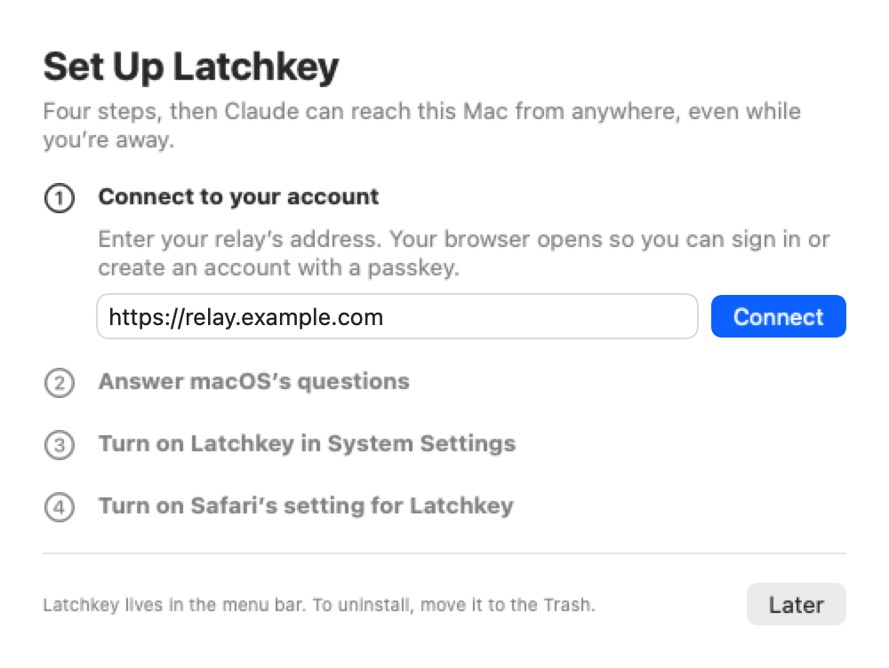
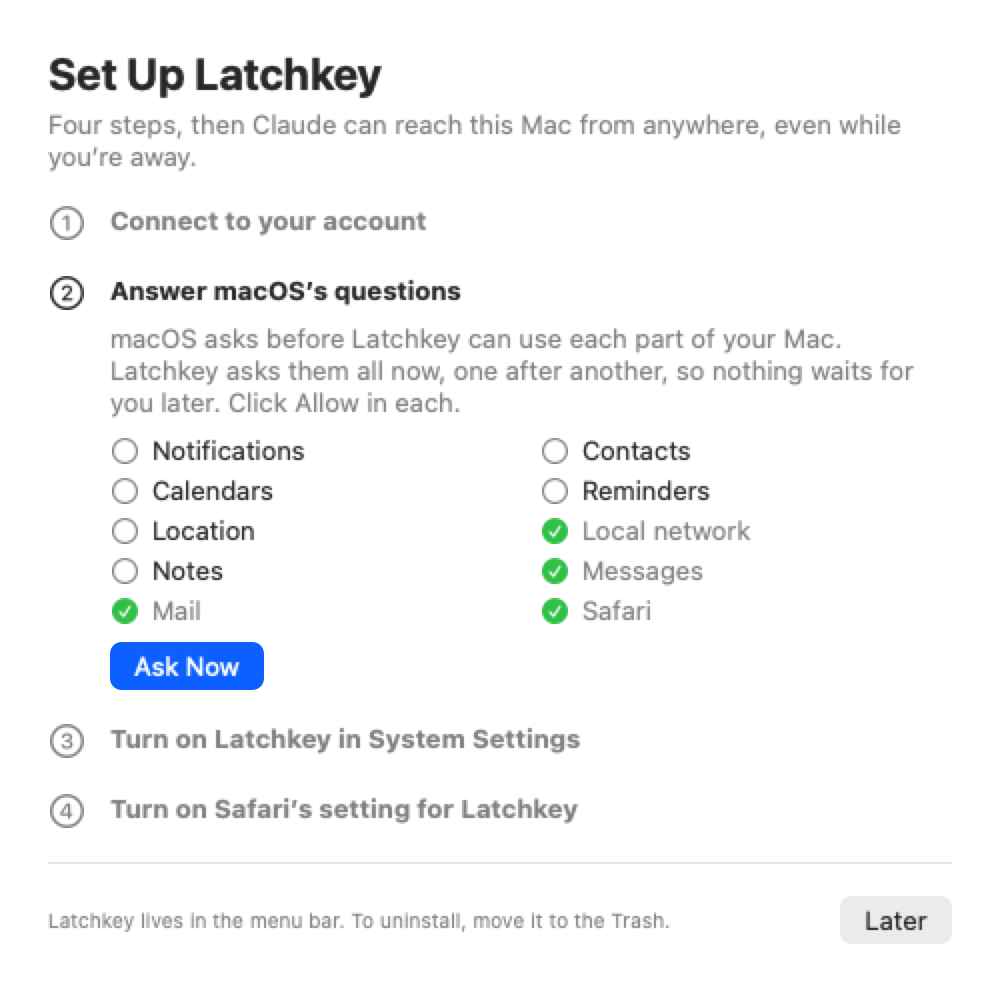
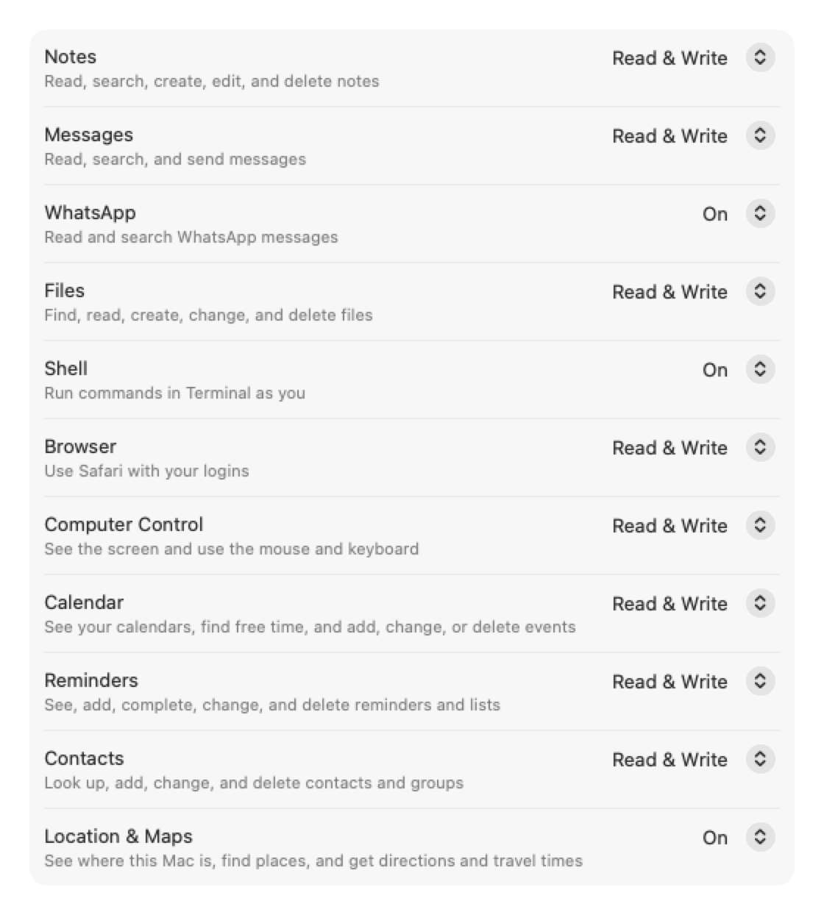
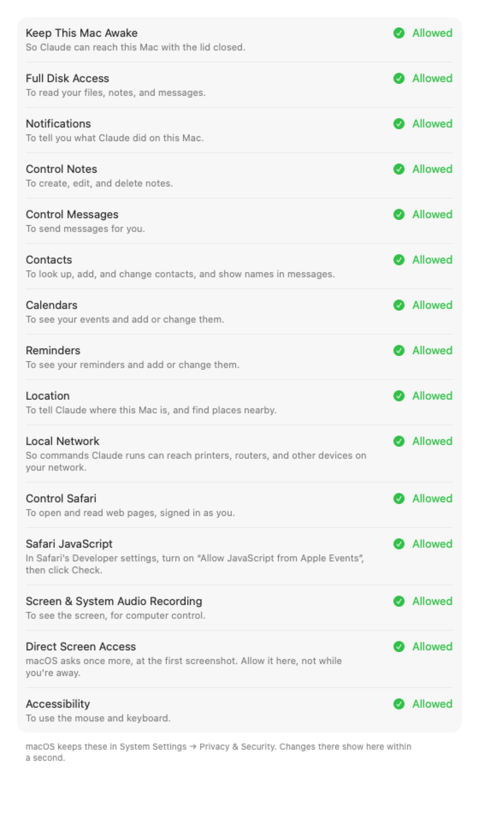

# Latchkey

**Your Mac, and your Linux servers, at Claude's fingertips from anywhere.**

Latchkey lets Claude on the web, Claude Desktop, and the Claude phone apps use your Mac, even
when it sits at home behind a router with the lid closed. From your phone, ask Claude to add eggs
to your grocery note, find what Sarah said about Saturday, send a text, read a PDF in Downloads,
run a command, check a site you're signed in to in Safari, or look at your screen. When the Mac is
asleep or offline, Claude says so right away, and why, instead of hanging.

Linux servers can join too: a home server, a Raspberry Pi, or a rented server, all behind the
same connector. Claude lists your machines, picks the one you mean, and runs commands or reads
and changes files there.

Free and open source (Apache-2.0). Apple silicon Macs, macOS 26 or later; 64-bit Linux with
systemd (Intel or Arm).

## How it works

```
Claude (web, Desktop, phone)  ──HTTPS──▶  Latchkey relay  ◀──outbound WebSocket──  Mac app (menu bar)
                                          (always on)     ◀──outbound WebSocket──  Linux server program
```

- The **Mac app** lives in the menu bar and keeps one outbound connection to the relay. Nothing
  connects in to your Mac: no open ports, no router settings, no tunnels.
- The **Linux server program** is one file, run by systemd as your own account. It too only
  connects out.
- **Several machines, one connector.** Pair as many Macs and servers as you like with one
  account. A tool both kinds offer appears once, with a `machine` argument; Claude's `machines`
  tool lists your machines, whether each is online, and what each offers, and every answer
  names the machine that answered and your other machines.
- The **relay** is the MCP server Claude connects to as a custom connector. It handles sign-in
  (passkeys, no passwords), remembers your Mac's last state, and answers instantly when the Mac
  is away. Claude asks for your approval every time it connects: Latchkey's Allow page appears on
  each sign-in from a Claude app, and nothing is approved silently.
- **Claude's work leaves nothing behind.** A shell command writes only to its own scratch folder, the folder it
  runs in, Downloads, package caches, and what Claude declares; opening apps, scripting other apps, and
  changing settings work only when Claude declares them; what it leaves running is stopped when it
  finishes unless Claude asks to keep it for a while, however it slipped away; its scratch folder goes to the Trash. Claude's Safari
  tab (a background tab in your window, or a window of its own if you choose) closes after 30 minutes unused. The Activity window's Left Behind view lists what was kept, removed,
  and made, and you're notified only of what nobody meant to leave.
- **You see who has access.** Latchkey's Settings window and your account page list the Claude apps that can use
  your Mac, and you can remove any one of them.
- **You choose what Claude can do.** Each capability has a level in Latchkey's Settings window; a capability that's
  off doesn't exist as far as Claude knows. Most have Off, Read only, and Read & write; Shell and
  Location & Maps are Off or On. Claude sees 23 tools from a Mac, plus the relay's `machines`:

  | Capability | Read only | Read & write adds |
  |---|---|---|
  | Notes | `notes_find`, `notes_read` | `notes_change` (create, append, replace, edit, delete notes or folders to Recently Deleted) |
  | Messages | `messages_find`, `messages_read` | `messages_send` (text and files) |
  | Files | `files_find`, `files_read` (text, PDFs, documents, images) | `files_change` (write, edit, folders, move, copy, Trash) |
  | Shell | | `shell_run`, `shell_check` (long and interactive commands; writes fenced, leftovers removed) |
  | Browser (your Safari, your logins) | `browser_read` | `browser_act` (click, type, script) |
  | Computer control (while unlocked) | `computer_look` | `computer_act` (mouse, keyboard, apps) |
  | Calendar (every account on the Mac) | `calendar_find` (events, free time) | `calendar_change` (create, move, repeat, delete) |
  | Reminders | `reminders_find` | `reminders_change` (create, complete, change, delete; new and deleted lists) |
  | Contacts | `contacts_find` (cards, photos) | `contacts_change` (create, change, delete; groups and their members) |
  | Mail (every account in Apple Mail) | `mail_find`, `mail_read` | `mail_change` (read, flag, move, junk, delete to Trash, draft), `mail_send` (new, reply, forward, with files; through Mail's own window, so the screen must be on) |
  | Location & Maps | `location_read`, `maps_find` (places, directions, travel times) | |

- **You see what Claude did:** a notification for every change and every new Claude connection,
  a busy dot while it works, and recent activity in the menu (what was run, read, or opened).
- **You see at a glance whether Claude can reach your Mac:** a solid key in the menu bar when it
  can, a key with a line through it when it can't, and a small mark when paused or when setup
  isn't finished.
- **It stays connected by itself:** after a dropped network, a sleep, or a relay restart, the app
  reconnects on its own and never gives up while it's paired; only one copy of it runs at a time.
- **You hear when a permission goes missing:** if one of Latchkey's macOS permissions or settings
  is turned off later, a notification says which one; click it to turn it back on.
- **You can pause Claude in one click:** Pause Claude's Access in the menu stops everything that
  is running and answers every request with "paused" until you resume, even across restarts.
- **Every answer carries the Mac's state** (battery, power, keep-awake), so Claude can warn you
  before the Mac sleeps.
- **Keep-awake:** while connected, the app keeps the Mac awake, lid closed included, and lets it
  sleep when the battery reaches 15% or it gets too hot.
- **Privacy:** the relay never stores what tools return. It keeps a list of which tools ran, when,
  and for which Claude app, plus connections, sign-ins, and refused requests, until you delete
  your account; the full log, with arguments and results, and the app's own events, stays on
  your Mac, encrypted and checked for changes, until you uninstall the app. After each
  connection the Mac checks its log against the relay's list, call by call. Text written
  by others (messages, web pages, files) is marked as content, not instructions.

## What it looks like

| Setup: connect, then answer macOS's questions | |
|---|---|
|  |  |
| **Settings → What Claude Can Do:** a level for each capability | **Settings → Permissions:** every macOS approval and whether it's given |
|  |  |

The pictures are drawn by the app's own views with sample data (`macos/scripts/readme-shots.sh`
redraws them).

## Get started

1. **Install the Mac app.** Open `Latchkey.dmg`, drag Latchkey to Applications, and open it. The
   setup window walks you through each step, one at a time: allow keep-awake, connect to a relay
   (you create your account there with a passkey), and every macOS permission any capability
   can use, whatever you turn on, so macOS never stops to ask while you're away (Full Disk
   Access; Notifications; control of Notes, Messages, Mail, and Safari; Contacts; Calendars;
   Reminders; Location; Local Network; Screen Recording and macOS's follow-up screen question;
   Accessibility; and Safari's "Allow JavaScript from Apple Events"). Right after you connect,
   Latchkey asks each macOS question in turn, then opens each System Settings page you need, one
   after another, as you turn Latchkey on. Later, the
   Permissions tab in Latchkey's Settings window shows each one and whether it's allowed. No
   relay yet? The first step's Copy Request gives you a request to paste into Claude Code, which
   sets one up for you on a free server ([docs/setup-with-claude.md](docs/setup-with-claude.md)).
2. **Connect Claude.** On claude.ai, open Settings → Connectors → Add custom connector, and enter
   your relay's address followed by `/mcp`, for example `https://relay.example.com/mcp`. Sign
   in with your passkey and click Allow. The connector then appears in Claude Desktop and the
   phone apps too.
3. **Ask Claude:** "What's in my grocery note?", "What did Sarah say about dinner?", "How much
   disk space is free?".

The full checklist is in [specs/001-core/quickstart.md](specs/001-core/quickstart.md).

**Uninstall:** move Latchkey to the Trash. It disconnects from your account, restores normal
sleep, removes its background items and local data, and quits.

### Add a Linux server

On the server, as yourself (not root), with your relay's address:

```sh
curl -fsSL https://raw.githubusercontent.com/tonimelisma/latchkey/main/linux/install.sh | sh -s -- https://relay.example.com
```

It shows a code: open your relay's `/link` page on any device where you're signed in, type the
code, and click Connect. The service starts (sudo asks for your password once if it needs one),
comes back after every reboot, and updates itself, checking each update's signature. On the
server, `latchkey shell on|off` and `latchkey files off|read|write` choose what Claude can do
there (Shell on and Files read & write to start), `latchkey pause` stops everything, `latchkey
activity` shows what Claude did, and `latchkey uninstall` removes it all. Commands run in bash
as you; sudo works for what you allowed without a password and otherwise answers at once (it
never waits for one); whatever a command leaves running is stopped when it finishes, sudo's too.
Deleting a file on a server deletes it for good. Details:
[specs/010-multi-host/contracts/server-program.md](specs/010-multi-host/contracts/server-program.md).

## Run your own relay

One container with one data volume, behind HTTPS. See
[docs/self-hosting.md](docs/self-hosting.md).

Out of the box, a relay accepts only Claude's own apps; other apps must be allowed by the person
running it (`ALLOWED_CLIENT_HOSTS`). The relay's signing keys are encrypted on disk under a key
file kept apart from the database. If others sign up on your relay, set `OPERATOR_NAME` and
`OPERATOR_CONTACT`: the relay then publishes its own terms and privacy policy. To deal with
abuse, the relay has commands to list, suspend, and delete accounts and to block addresses; a
suspended account's Mac says so and reconnects by itself once the suspension is lifted.

If a reverse proxy in another container or on another host forwards to the relay, set
`TRUSTED_PROXIES` to its address or network range (comma-separated IP addresses and CIDR ranges,
for example `172.18.0.0/16`). The relay believes the client address in `X-Forwarded-For` only from
those proxies and from a proxy on the same machine. Behind a reverse proxy, publish the relay's
port on `127.0.0.1` only (or use a private Docker network), so nothing reaches it around the proxy.

## Status

Version 0.8 is in testing: every capability is built and checked live on a real Mac. The source
is public; there are no releases yet. The app isn't notarized, so a copy built by someone else
opens only after System Settings → Privacy & Security → Open Anyway, and the relay's image isn't
published yet; a setup that Claude Code runs for you on a free server is being specified
([specs/009-easy-relay-setup](specs/009-easy-relay-setup/spec.md)). See
[docs/STATUS.md](docs/STATUS.md).

## Security

Report vulnerabilities privately; see [SECURITY.md](SECURITY.md). The threat model (what is
protected, from whom, and which risks are accepted) is in [docs/threat-model.md](docs/threat-model.md);
how Latchkey follows current best practice is in [docs/best-practices.md](docs/best-practices.md).
Every deploy first passes `make -C relay security`: known vulnerabilities in the relay's code and
dependencies (govulncheck, OSV-Scanner) and in the Mac app's Sparkle, leaked secrets (gitleaks),
static analysis of the Go and Swift code with Latchkey's own rules (Semgrep), and the shell
scripts (ShellCheck).

## Development

| Part | Where | Commands |
|---|---|---|
| Relay (Go) | `relay/` | `make test`, `make lint`, `make run`, `make claude-check`, `make mac-check` |
| Linux server program (Go) | `linux/` | `make test`, `make lint`, `make test-linux` (every test on Debian with systemd in Docker), `make check` (end to end: relay, pretend Mac, the program installed in a container, a real MCP client), `make release` |
| Mac app and helper (Swift) | `macos/` | `make test`, `make lint`, `make run`, `make dmg`, `make install` (build, install into Applications, start, and fail if the update lost the pairing), `scripts/readme-shots.sh` (redraws the README's pictures) |
| Hosted relay deployment | `deploy/` | `deploy/deploy.sh` |
| Cleanup after merging | `scripts/` | `scripts/tidy.sh` (runs automatically after every push and at every session start from Claude Code; removes worktrees as soon as their work is merged); `scripts/loose-ends.sh` lists work not yet on main (checked when a Claude Code session starts and before each turn ends) |

### How this repo is organized (spec-driven)

Work starts as a written spec and flows downward. Code is the last step, not the first.

```
CLAUDE.md                       Instructions for Claude Code sessions (process, rules, commands).
docs/STATUS.md                  Current phase, next steps, risks, open questions.
docs/decisions.md               Index of approved decisions, linking to the specs.
memory/constitution.md          Non-negotiable principles. Every plan is checked against them.
specs/001-core/
  spec.md                       WHAT and WHY: user stories, requirements, success criteria. No tech.
  plan.md                       HOW: architecture and technology choices, each traced to a requirement.
  research.md                   Evidence behind the plan, with sources.
  data-model.md                 Entities the relay stores.
  contracts/
    agent-protocol.md           Mac app <-> relay WebSocket protocol.
    mcp-surface.md              What Claude sees: endpoints, OAuth, tools, offline behavior.
  tasks.md                      Ordered, testable tasks generated from plan + contracts.
relay/                          The relay (Go). `make test`, `make run`; see CLAUDE.md for commands.
macos/                          The Mac app and its helper (Swift, XcodeGen). `make test`, `make run`.
linux/                          The Linux server program (Go). `make test`, `make test-linux`.
specs/002-notes-messages/       Notes and Messages (same structure for each capability).
specs/003-files/                Files.
specs/004-shell/                Shell.
specs/005-browser/              Browser control (Safari).
specs/006-computer-control/     Computer control.
specs/007-calendar-reminders-contacts-location/  Calendar, Reminders, Contacts, Location & Maps.
specs/008-mail/                 Mail.
specs/009-easy-relay-setup/     A relay set up by Claude Code.
specs/010-multi-host/           Several machines and Linux servers.
docs/best-practices.md          Research on best practices, checked against Latchkey.
docs/threat-model.md            What is protected, attackers, trust boundaries, accepted risks.
docs/self-hosting.md            Run your own relay.
docs/images/                    The README's pictures (drawn by macos/scripts/readme-shots.sh).
SECURITY.md                     How to report vulnerabilities.
```

Personal deployment details (the hosted relay's address, server, signing team) live only in
gitignored files: `.env`, `macos/Config/Local.xcconfig`, and `CLAUDE.local.md`.
